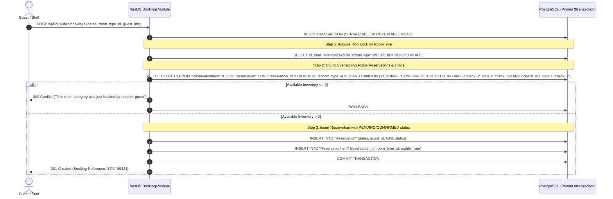

# 🏛️ StayPilot — Architecture & Engineering Specification

## 1. Executive Summary & Vision
**StayPilot** is a multi-tenant Hotel Booking & Operations SaaS crafted specifically for small and independent boutique hotels, guesthouses, and eco-resorts in Cambodia (Siem Reap, Phnom Penh, Kampot, Koh Rong).
Instead of competing with giant OTAs (Booking.com/Agoda) with heavy 15-25% commissions, StayPilot empowers property owners to:
1. Publish their own **high-converting, direct booking website** (Khmer + English, mobile-first, USD + KHR, pay-at-property & local KHQR/ABA PayWay ready).
2. Centralize reservations in a **streamlined front-desk dashboard** to eliminate double-bookings across walk-ins, phone calls, Telegram, and web bookings.
3. Keep operational overhead minimal with automated confirmations, simple room inventory, and instant check-in/out tracking.

---

## 2. Monorepo & System Architecture

We employ a clean, modular monolith architecture with strict separation of concerns, containerized local dev, and single-tenant data isolation logic enforced at the database and application layer.

```
StayPilot/
├── apps/
│   ├── web/                     # Next.js 15+ (App Router), Tailwind CSS, Lucide, Framer Motion
│   │   ├── app/
│   │   │   ├── (public)/        # Landing page, public hotel directory
│   │   │   ├── [hotelSlug]/     # Hotel-branded public direct booking engine
│   │   │   │   ├── page.tsx     # Hotel overview, rooms, amenities, location
│   │   │   │   ├── rooms/       # Room type detail views
│   │   │   │   ├── book/        # Date picker, guest info, rate selection
│   │   │   │   └── confirmation/# Verified booking confirmation voucher
│   │   │   ├── dashboard/       # Multi-tenant Hotel Owner/Staff Portal
│   │   │   │   ├── calendar/    # Visual reservation timeline & tape-chart
│   │   │   │   ├── reservations/# List, filter, search, create manual booking
│   │   │   │   ├── rooms/       # Room types, physical rooms & maintenance status
│   │   │   │   ├── pricing/     # Rate plans, weekend rates & seasonal rules
│   │   │   │   ├── guests/      # Guest CRM, past stays, notes
│   │   │   │   ├── reports/     # Occupancy, RevPAR, ADR, revenue stats
│   │   │   │   ├── staff/       # Role-based access control (Owner, Manager, Staff)
│   │   │   │   └── settings/    # Hotel profile, policies, payment preferences
│   │   │   └── admin/           # Platform Superadmin (Subscriptions, Hotels)
│   │   ├── components/          # Apple/Hospitality design components (Ivory & Forest Green)
│   │   └── lib/                 # API client, i18n (Khmer/English), currency formatters
│   │
│   └── api/                     # NestJS Modular Backend API
│       ├── src/
│       │   ├── common/          # TenantInterceptor, CurrentHotel decorator, Guards, Filters
│       │   ├── config/          # Type-safe env validation (Joi/Zod)
│       │   ├── database/        # PrismaService, transaction helpers, soft-delete extensions
│       │   └── modules/
│       │       ├── auth/        # JWT auth, refresh token rotation, password hashing
│       │       ├── tenancy/     # Hotel onboarding, domain/slug resolution, isolation
│       │       ├── rooms/       # RoomTypes, physical Rooms, housekeeping statuses
│       │       ├── rates/       # RatePlans, currency rules (USD/KHR exchange rates)
│       │       ├── inventory/   # Concurrency-safe availability calculations & hold engine
│       │       ├── bookings/    # Reservation workflow, date range validation, voucher generator
│       │       ├── guests/      # Guest directory & stay history
│       │       ├── payments/    # Payment provider interface (Cash, ABA PayWay / KHQR abstraction)
│       │       ├── billing/     # SaaS subscription management (Starter, Pro, Business)
│       │       └── reports/     # Aggregated analytics (Occupancy rate, ADR, Revenue)
│       └── prisma/
│           ├── schema.prisma    # Canonical database schema
│           ├── migrations/      # Version-controlled SQL migrations
│           └── seed.ts          # Realistic Cambodian boutique hotel seed data
│
├── packages/
│   └── shared-types/            # Shared DTOs, Enums, and API contracts
├── docker-compose.yml           # PostgreSQL 16 & pgAdmin for local development
└── package.json                 # Turborepo / npm workspaces configuration
```

---

## 3. Strict Multi-Tenancy & Security Rules

1. **Logical Tenant Isolation**:
   - Every single operational entity (`RoomType`, `Room`, `RatePlan`, `Reservation`, `Guest`, `Payment`) carries an immutable `hotel_id UUID` foreign key.
   - In NestJS, a global `TenantInterceptor` or `TenantGuard` extracts the authenticated user's `hotel_id` from their cryptographically signed JWT.
   - Every database query through Prisma MUST be scoped to `hotel_id`. Direct lookups by raw `id` without checking `hotel_id` are strictly forbidden to prevent Insecure Direct Object Reference (IDOR).
   - Public booking queries resolve the `hotel_id` strictly via the verified hotel `slug` or custom domain.

2. **Role-Based Access Control (RBAC)**:
   - **PLATFORM_ADMIN**: Manages platform billing, audits hotel subscriptions, platform-wide settings.
   - **HOTEL_OWNER**: Full ownership of hotel profile, bank payout details, subscription tier, staff invitations, financial reports.
   - **HOTEL_MANAGER**: Can create/cancel bookings, adjust rates, manage rooms and view operational reports.
   - **HOTEL_STAFF / RECEPTIONIST**: Check-in/check-out, view today's arrivals/departures, create walk-in reservations, toggle room housekeeping status.
   - **GUEST (Public)**: Unauthenticated public access to search availability, lock room holds, and create reservations.

---

## 4. Double-Booking Prevention & Concurrency Architecture

Preventing double bookings in hospitality is non-trivial because bookings span **date ranges** (`[check_in, check_out)`) across both **room type allocations** (pooled inventory) and **physical room assignments** (e.g., Room 204).

### The Dual-Tier Inventory Model:
1. **Tier 1: RoomType Capacity (Pool level)**:
   - Example: "Angkor Garden" has 5 *Deluxe Balcony Rooms*.
   - When a guest searches online for Oct 25 to Oct 28, the booking engine calculates availability per night:
     $$\text{Available}(date) = \text{Total Active Rooms}(RoomType) - \text{Active Bookings}(RoomType, date) - \text{Active Holds}(RoomType, date)$$
2. **Tier 2: Physical Room Allocation (Operational level)**:
   - Staff can assign a specific room (e.g., Room 102) either upon booking or at check-in.
   - When a physical room is assigned, it is protected by an explicit check ensuring no two overlapping reservations occupy that specific room.

### Atomic Concurrency Control Strategy:
To guarantee that two guests or a receptionist and a web guest do not book the final room simultaneously, we employ a 3-layer guardrail:



### Temporary Hold Engine (Cart TTL):
- For online bookings selecting pay-at-property or initiating digital payment, a temporary hold with a 15-minute expiration timestamp (`expires_at`) is created.
- Background worker / NestJS scheduled cron job automatically sets expired `PENDING` holds to `EXPIRED` if not confirmed within 15 minutes, instantly releasing inventory back to the pool.

---

## 5. Payment Provider Abstraction (ABA PayWay / KHQR Ready)

Small hotels in Cambodia operate on two primary rails:
1. **Pay at Hotel / Cash on Arrival / Walk-in** (No upfront gateway fee, zero friction for local travelers).
2. **Direct Bank Transfer / KHQR (Bakong / ABA PayWay)** (Scanned QR code via mobile banking).

We build a clean polymorphic payment interface:
```typescript
export interface IPaymentProvider {
  createPaymentIntent(params: CreatePaymentDto): Promise<PaymentIntentResult>;
  verifyWebhook(headers: Record<string, string>, payload: any): Promise<WebhookVerificationResult>;
  queryTransactionStatus(transactionRef: string): Promise<PaymentStatusResult>;
}
```
- **Cash / Pay-at-Property Provider**: Marks payment status as `PENDING_AT_PROPERTY`, enabling immediate reservation confirmation without gateway blockers.
- **Manual Bank QR / Slip Upload**: Generates hotel's official Bakong KHQR code and allows guest to upload transfer reference or slip, with front-desk manual 1-click verification.
- **ABA PayWay Gateway Adapter**: Pluggable driver adhering to ABA PayWay HMAC-SHA512 signature hashing and webhook notification verification with replay attack prevention (`processed_webhooks` table).

---

## 6. UI/UX Design Direction: Calm Hospitality Aesthetics
- **Color Palette**:
  - Background: Warm Editorial Ivory (`#FBF9F5` / `#F5F2EB`)
  - Primary / Accents: Deep Khmer Forest Green (`#143823` / `#0D2617`)
  - Warm Highlights: Muted Champagne Gold (`#C8A97E` / `#B89358`)
  - Text: Rich Slate Charcoal (`#1F2923` / `#333F38`)
  - Borders: Warm Sandstone Grey (`#E6E1D8`)
- **Typography**:
  - Display / Editorial: *Playfair Display* or *Outfit* for boutique hotel grandeur.
  - Body & Numbers: *Plus Jakarta Sans* or *Inter* with tabular numbers (`font-mono` / `tabular-nums`) for pricing and dates.
  - Khmer Script: *Kantumruy Pro* / *Battambang* font pairings with natural line-height balance.
