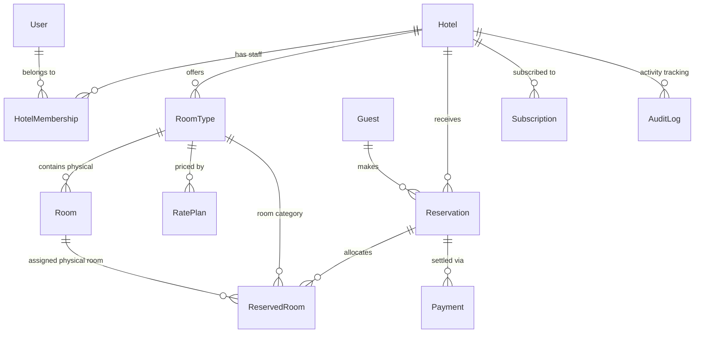

# 🗄️ StayPilot — Canonical Data Model Specification

This document defines the production PostgreSQL database schema managed via Prisma ORM for StayPilot.

## 1. Entity Relationship Diagram (ERD)



---

## 2. Prisma Schema Definition (`schema.prisma`)

```prisma
datasource db {
  provider = "postgresql"
  url      = env("DATABASE_URL")
}

generator client {
  provider = "prisma-client-js"
}

// -------------------------------------------------------------
// USER & ACCESS MANAGEMENT
// -------------------------------------------------------------

enum PlatformRole {
  SUPERADMIN
  USER
}

enum HotelRole {
  OWNER
  MANAGER
  RECEPTIONIST
}

model User {
  id            String            @id @default(uuid()) @db.Uuid
  email         String            @unique
  passwordHash  String            @map("password_hash")
  fullName      String            @map("full_name")
  phoneNumber   String?           @map("phone_number")
  avatarUrl     String?           @map("avatar_url")
  platformRole  PlatformRole      @default(USER) @map("platform_role")
  isActive      Boolean           @default(true) @map("is_active")
  createdAt     DateTime          @default(now()) @map("created_at") @db.Timestamptz
  updatedAt     DateTime          @updatedAt @map("updated_at") @db.Timestamptz

  memberships   HotelMembership[]
  auditLogs     AuditLog[]

  @@map("users")
}

model HotelMembership {
  id        String    @id @default(uuid()) @db.Uuid
  userId    String    @map("user_id") @db.Uuid
  hotelId   String    @map("hotel_id") @db.Uuid
  role      HotelRole @default(RECEPTIONIST)
  createdAt DateTime  @default(now()) @map("created_at") @db.Timestamptz

  user      User      @relation(fields: [userId], references: [id], onDelete: Cascade)
  hotel     Hotel     @relation(fields: [hotelId], references: [id], onDelete: Cascade)

  @@unique([userId, hotelId])
  @@index([hotelId])
  @@map("hotel_memberships")
}

// -------------------------------------------------------------
// HOTEL & MULTI-TENANCY
// -------------------------------------------------------------

model Hotel {
  id              String        @id @default(uuid()) @db.Uuid
  slug            String        @unique // e.g. "angkor-garden-resort"
  name            String
  descriptionKh   String?       @map("description_kh") @db.Text
  descriptionEn   String?       @map("description_en") @db.Text
  tagline         String?
  logoUrl         String?       @map("logo_url")
  coverImageUrl   String?       @map("cover_image_url")
  galleryUrls     String[]      @default([]) @map("gallery_urls")
  
  // Location & Contact
  addressLine     String        @map("address_line")
  city            String        // Siem Reap, Phnom Penh, Kampot, etc.
  province        String?
  country         String        @default("Cambodia")
  postalCode      String?       @map("postal_code")
  latitude        Float?
  longitude       Float?
  email           String
  phone           String
  telegramUsername String?      @map("telegram_username")
  
  // Hotel Policies & Localization
  checkInTime     String        @default("14:00") @map("check_in_time")
  checkOutTime    String        @default("12:00") @map("check_out_time")
  cancellationPolicy String?    @map("cancellation_policy") @db.Text
  defaultCurrency String        @default("USD") @map("default_currency") // USD or KHR
  usdToKhrRate    Int           @default(4100) @map("usd_to_khr_rate") // Exchange rate, e.g. 4100 KHR per 1 USD
  amenities       String[]      @default([]) // Swimming pool, High-speed Wi-Fi, Airport pickup, etc.
  
  isActive        Boolean       @default(true) @map("is_active")
  createdAt       DateTime      @default(now()) @map("created_at") @db.Timestamptz
  updatedAt       DateTime      @updatedAt @map("updated_at") @db.Timestamptz

  // Relations
  memberships     HotelMembership[]
  roomTypes       RoomType[]
  rooms           Room[]
  reservations    Reservation[]
  guests          Guest[]
  subscriptions   Subscription[]
  auditLogs       AuditLog[]

  @@index([city])
  @@map("hotels")
}

// -------------------------------------------------------------
// ROOM TYPES, PHYSICAL ROOMS & PRICING
// -------------------------------------------------------------

model RoomType {
  id              String        @id @default(uuid()) @db.Uuid
  hotelId         String        @map("hotel_id") @db.Uuid
  name            String        // Deluxe Balcony King, Family Bungalow, Khmer Traditional Villa
  slug            String        // deluxe-balcony-king
  descriptionEn   String?       @map("description_en") @db.Text
  descriptionKh   String?       @map("description_kh") @db.Text
  maxAdults       Int           @default(2) @map("max_adults")
  maxChildren     Int           @default(1) @map("max_children")
  totalInventory  Int           @default(1) @map("total_inventory") // Total number of rooms in this category
  bedConfiguration String       @default("1 King Bed") @map("bed_configuration")
  roomSizeSqm     Float?        @map("room_size_sqm")
  photos          String[]      @default([])
  amenities       String[]      @default([])
  basePriceInCents Int          @map("base_price_in_cents") // Stored in USD cents (e.g. 4500 = $45.00)
  
  isActive        Boolean       @default(true) @map("is_active")
  createdAt       DateTime      @default(now()) @map("created_at") @db.Timestamptz
  updatedAt       DateTime      @updatedAt @map("updated_at") @db.Timestamptz

  hotel           Hotel         @relation(fields: [hotelId], references: [id], onDelete: Cascade)
  physicalRooms   Room[]
  ratePlans       RatePlan[]
  reservedRooms   ReservedRoom[]

  @@unique([hotelId, slug])
  @@index([hotelId])
  @@map("room_types")
}

enum HousekeepingStatus {
  CLEAN
  DIRTY
  INSPECTED
  OUT_OF_SERVICE
}

model Room {
  id              String             @id @default(uuid()) @db.Uuid
  hotelId         String             @map("hotel_id") @db.Uuid
  roomTypeId      String             @map("room_type_id") @db.Uuid
  roomNumber      String             @map("room_number") // e.g. "101", "Villa 3"
  floor           Int?               @default(1)
  housekeeping    HousekeepingStatus @default(CLEAN)
  notes           String?
  isActive        Boolean            @default(true) @map("is_active")
  createdAt       DateTime           @default(now()) @map("created_at") @db.Timestamptz
  updatedAt       DateTime           @updatedAt @map("updated_at") @db.Timestamptz

  hotel           Hotel              @relation(fields: [hotelId], references: [id], onDelete: Cascade)
  roomType        RoomType           @relation(fields: [roomTypeId], references: [id], onDelete: Restrict)
  reservedRooms   ReservedRoom[]

  @@unique([hotelId, roomNumber])
  @@index([hotelId])
  @@index([roomTypeId])
  @@map("rooms")
}

model RatePlan {
  id                String    @id @default(uuid()) @db.Uuid
  roomTypeId        String    @map("room_type_id") @db.Uuid
  name              String    // "Standard Flexible", "Non-Refundable Breakfast Included"
  description       String?
  priceModifierType String    @default("PERCENTAGE") // "PERCENTAGE" or "FIXED"
  priceModifierValue Float    @default(0.0) // e.g. -10 for 10% discount or +1500 for $15 add-on
  includesBreakfast Boolean   @default(false) @map("includes_breakfast")
  cancellationFreeHours Int   @default(48) @map("cancellation_free_hours") // Free cancellation up to 48 hrs before
  isActive          Boolean   @default(true) @map("is_active")
  createdAt         DateTime  @default(now()) @map("created_at") @db.Timestamptz
  updatedAt         DateTime  @updatedAt @map("updated_at") @db.Timestamptz

  roomType          RoomType  @relation(fields: [roomTypeId], references: [id], onDelete: Cascade)

  @@index([roomTypeId])
  @@map("rate_plans")
}

// -------------------------------------------------------------
// GUEST CRM & RESERVATIONS
// -------------------------------------------------------------

model Guest {
  id              String        @id @default(uuid()) @db.Uuid
  hotelId         String        @map("hotel_id") @db.Uuid
  fullName        String        @map("full_name")
  email           String
  phone           String
  country         String?       @default("Cambodia")
  nationalIdOrPassport String?  @map("national_id_or_passport")
  notes           String?       @db.Text
  createdAt       DateTime      @default(now()) @map("created_at") @db.Timestamptz
  updatedAt       DateTime      @updatedAt @map("updated_at") @db.Timestamptz

  hotel           Hotel         @relation(fields: [hotelId], references: [id], onDelete: Cascade)
  reservations    Reservation[]

  @@index([hotelId, email])
  @@index([hotelId, phone])
  @@map("guests")
}

enum ReservationStatus {
  PENDING       // Waiting for confirmation or hold payment
  CONFIRMED     // Confirmed booking
  CHECKED_IN    // Guest is currently staying in room
  CHECKED_OUT   // Guest has departed
  CANCELLED     // Cancelled
  NO_SHOW       // Guest did not arrive
}

enum BookingSource {
  DIRECT_WEBSITE
  FRONT_DESK
  TELEGRAM_PHONE
  WALK_IN
}

model Reservation {
  id                String            @id @default(uuid()) @db.Uuid
  hotelId           String            @map("hotel_id") @db.Uuid
  guestId           String            @map("guest_id") @db.Uuid
  bookingReference  String            @unique @map("booking_reference") // e.g. "SP-2610-8941"
  checkInDate       DateTime          @map("check_in_date") @db.Date
  checkOutDate      DateTime          @map("check_out_date") @db.Date
  adultsCount       Int               @default(1) @map("adults_count")
  childrenCount     Int               @default(0) @map("children_count")
  status            ReservationStatus @default(PENDING)
  source            BookingSource     @default(DIRECT_WEBSITE)
  
  // Financials (All in integer cents to avoid floating point bugs)
  subtotalInCents   Int               @map("subtotal_in_cents")
  taxInCents        Int               @default(0) @map("tax_in_cents")
  totalAmountInCents Int              @map("total_amount_in_cents")
  currency          String            @default("USD")
  
  specialRequests   String?           @map("special_requests") @db.Text
  internalStaffNotes String?          @map("internal_staff_notes") @db.Text
  holdExpiresAt     DateTime?         @map("hold_expires_at") @db.Timestamptz
  
  createdAt         DateTime          @default(now()) @map("created_at") @db.Timestamptz
  updatedAt         DateTime          @updatedAt @map("updated_at") @db.Timestamptz

  hotel             Hotel             @relation(fields: [hotelId], references: [id], onDelete: Cascade)
  guest             Guest             @relation(fields: [guestId], references: [id], onDelete: Restrict)
  reservedRooms     ReservedRoom[]
  payments          Payment[]

  @@index([hotelId, status])
  @@index([hotelId, checkInDate, checkOutDate])
  @@index([bookingReference])
  @@map("reservations")
}

model ReservedRoom {
  id              String      @id @default(uuid()) @db.Uuid
  reservationId   String      @map("reservation_id") @db.Uuid
  roomTypeId      String      @map("room_type_id") @db.Uuid
  roomId          String?     @map("room_id") @db.Uuid // Nullable until physical room is assigned
  nightlyPriceInCents Int     @map("nightly_price_in_cents")

  reservation     Reservation @relation(fields: [reservationId], references: [id], onDelete: Cascade)
  roomType        RoomType    @relation(fields: [roomTypeId], references: [id], onDelete: Restrict)
  assignedRoom    Room?       @relation(fields: [roomId], references: [id], onDelete: SetNull)

  @@index([reservationId])
  @@index([roomTypeId])
  @@index([roomId])
  @@map("reserved_rooms")
}

// -------------------------------------------------------------
// PAYMENTS & BILLING
// -------------------------------------------------------------

enum PaymentMethod {
  PAY_AT_HOTEL_CASH
  BANK_TRANSFER_KHQR
  ABA_PAYWAY
  CREDIT_CARD
}

enum PaymentStatus {
  PENDING
  AUTHORIZED
  SETTLED
  FAILED
  REFUNDED
}

model Payment {
  id              String        @id @default(uuid()) @db.Uuid
  reservationId   String        @map("reservation_id") @db.Uuid
  amountInCents   Int           @map("amount_in_cents")
  currency        String        @default("USD") // USD or KHR
  method          PaymentMethod @map("method")
  status          PaymentStatus @default(PENDING)
  transactionRef  String?       @map("transaction_ref") // ABA PayWay transaction ID or bank transfer ref
  proofImageUrl   String?       @map("proof_image_url") // Receipt screenshot if bank transfer
  idempotencyKey  String?       @unique @map("idempotency_key")
  notes           String?
  settledAt       DateTime?     @map("settled_at") @db.Timestamptz
  createdAt       DateTime      @default(now()) @map("created_at") @db.Timestamptz

  reservation     Reservation   @relation(fields: [reservationId], references: [id], onDelete: Cascade)

  @@index([reservationId])
  @@index([transactionRef])
  @@map("payments")
}

// -------------------------------------------------------------
// SAAS SUBSCRIPTIONS & AUDITING
// -------------------------------------------------------------

enum SubscriptionTier {
  STARTER // $9/mo - 1 property, basic listings & bookings
  PRO     // $19/mo - Availability calendar, automation, multi-currency
  BUSINESS // $39/mo - Multi-property, unlimited staff, analytics
}

enum SubscriptionStatus {
  TRIALING
  ACTIVE
  PAST_DUE
  CANCELLED
}

model Subscription {
  id              String             @id @default(uuid()) @db.Uuid
  hotelId         String             @map("hotel_id") @db.Uuid
  tier            SubscriptionTier   @default(STARTER)
  status          SubscriptionStatus @default(TRIALING)
  trialEndsAt     DateTime?          @map("trial_ends_at") @db.Timestamptz
  currentPeriodStart DateTime        @default(now()) @map("current_period_start") @db.Timestamptz
  currentPeriodEnd   DateTime        @map("current_period_end") @db.Timestamptz
  monthlyPriceInCents Int            @map("monthly_price_in_cents") // 900, 1900, 3900
  createdAt       DateTime           @default(now()) @map("created_at") @db.Timestamptz
  updatedAt       DateTime           @updatedAt @map("updated_at") @db.Timestamptz

  hotel           Hotel              @relation(fields: [hotelId], references: [id], onDelete: Cascade)

  @@index([hotelId])
  @@map("subscriptions")
}

model AuditLog {
  id          String    @id @default(uuid()) @db.Uuid
  hotelId     String?   @map("hotel_id") @db.Uuid
  userId      String?   @map("user_id") @db.Uuid
  action      String    // e.g. "RESERVATION_CREATED", "STATUS_CHANGED", "PRICE_UPDATED"
  entityType  String    @map("entity_type") // e.g. "Reservation", "Room"
  entityId    String    @map("entity_id")
  details     Json?
  ipAddress   String?   @map("ip_address")
  createdAt   DateTime  @default(now()) @map("created_at") @db.Timestamptz

  hotel       Hotel?    @relation(fields: [hotelId], references: [id], onDelete: Cascade)
  user        User?     @relation(fields: [userId], references: [id], onDelete: SetNull)

  @@index([hotelId, createdAt])
  @@index([entityType, entityId])
  @@map("audit_logs")
}

model ProcessedWebhook {
  id          String   @id @default(uuid()) @db.Uuid
  provider    String   // "ABA_PAYWAY", "BAKONG", "STRIPE"
  eventId     String   @unique @map("event_id")
  payloadHash String   @map("payload_hash")
  processedAt DateTime @default(now()) @map("processed_at") @db.Timestamptz

  @@map("processed_webhooks")
}
```
