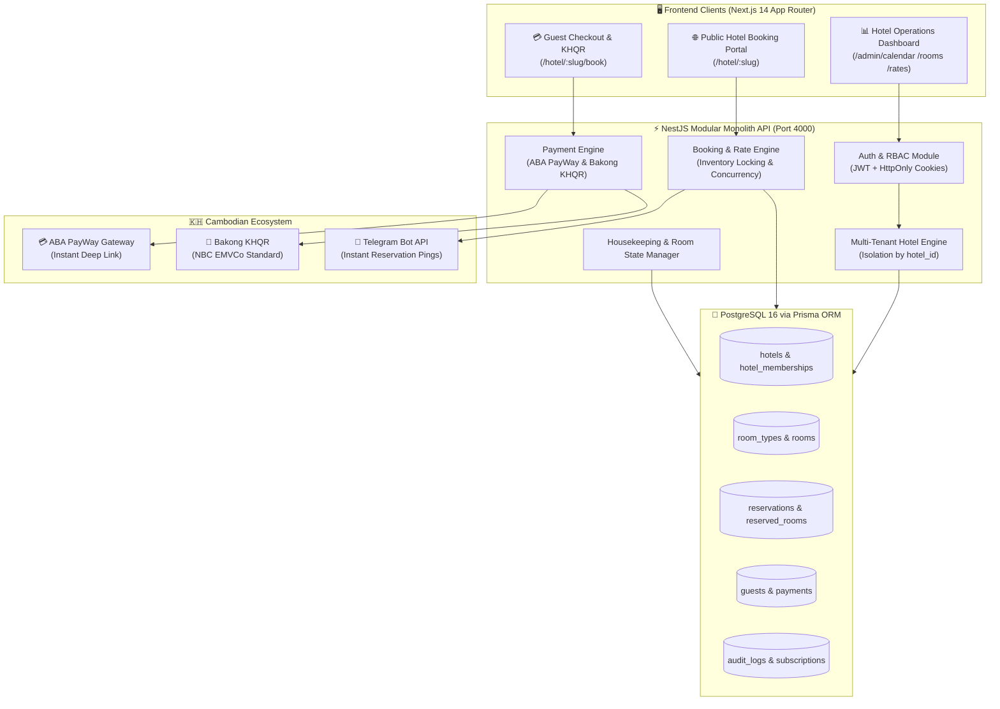
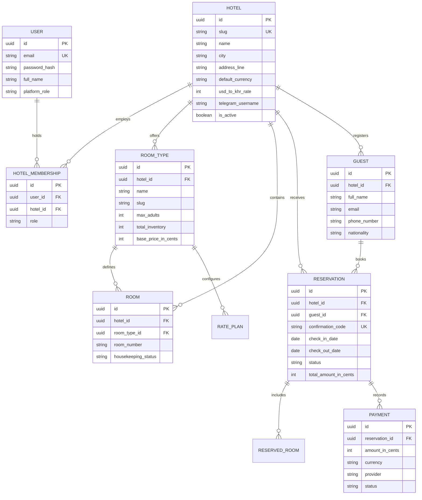
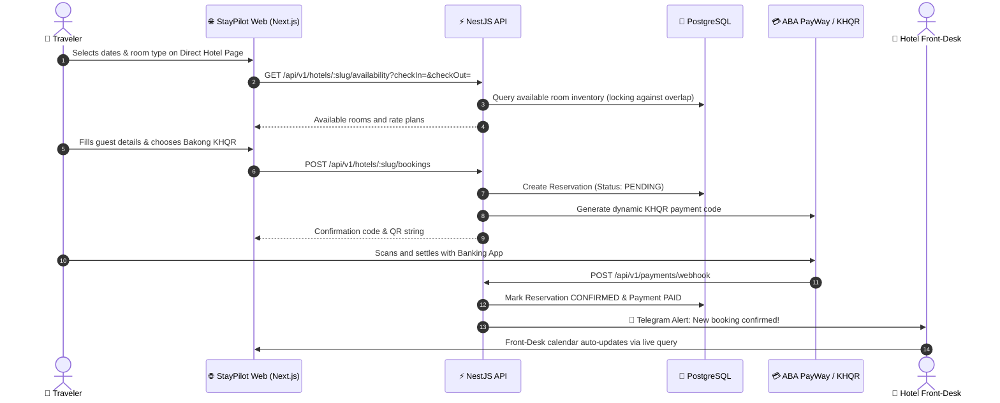

# 🏨 StayPilot — Hotel Booking & Operations SaaS for Cambodia

<div align="center">


**Production-grade multi-tenant hotel booking and front-desk management SaaS built specifically for boutique hotels, guesthouses, and eco-resorts across Cambodia (Siem Reap, Phnom Penh, Kampot, Koh Rong).**

[System Architecture](#-system-architecture) • [Database ERD](#-database-entity-relationship-erd) • [Booking Flow](#-guest-direct-booking--operations-flow) • [Quick Start](#-quick-start-guide)

</div>

---

## ⚡ Overview

**StayPilot** is an all-in-one hospitality engine designed to eliminate expensive OTA commissions. It delivers a fast, mobile-first direct booking guest portal with instantaneous **Bakong KHQR** and **ABA PayWay** checkout, alongside an operational front-desk calendar, housekeeping manager, and automated **Telegram** booking notification bot.

---

## 🏗️ System Architecture



---

## 📊 Database Entity Relationship (ERD)



---

## 🔄 Guest Direct Booking & Operations Flow



---

## 🎨 Hospitality Design System
- **Ivory Warmth**: Backgrounds (`#FAF8F5`, `#F5F1EB`)
- **Khmer Forest Green**: Primary brand accents (`#143823`, `#0C2416`)
- **Champagne Gold**: Subtle highlights (`#C8A97E`, `#BA9255`)
- **Slate Charcoal**: High-legibility typography (`#19211E`)
- **Dual Script & Currency**: Khmer (*Kantumruy Pro*) & English (*Inter*), real-time USD ($) and Riel (KHR) conversion.

---

## 🚀 Quick Start Guide

### 1. Start PostgreSQL with Docker
```bash
docker compose up -d
```

### 2. Install Dependencies (Monorepo with pnpm)
```bash
pnpm install
```

### 3. Generate Prisma Client & Run Seed
```bash
# Push schema to database
pnpm --filter api run prisma:push

# Seed realistic Cambodian boutique hotel data
pnpm --filter api run prisma:seed
```

### 4. Start Development Servers
```bash
# Starts both Next.js (port 3000) and NestJS API (port 4000)
pnpm run dev
```

---

## 📄 License
MIT License © **[Ros Rendo](https://github.com/RosRendo)**
